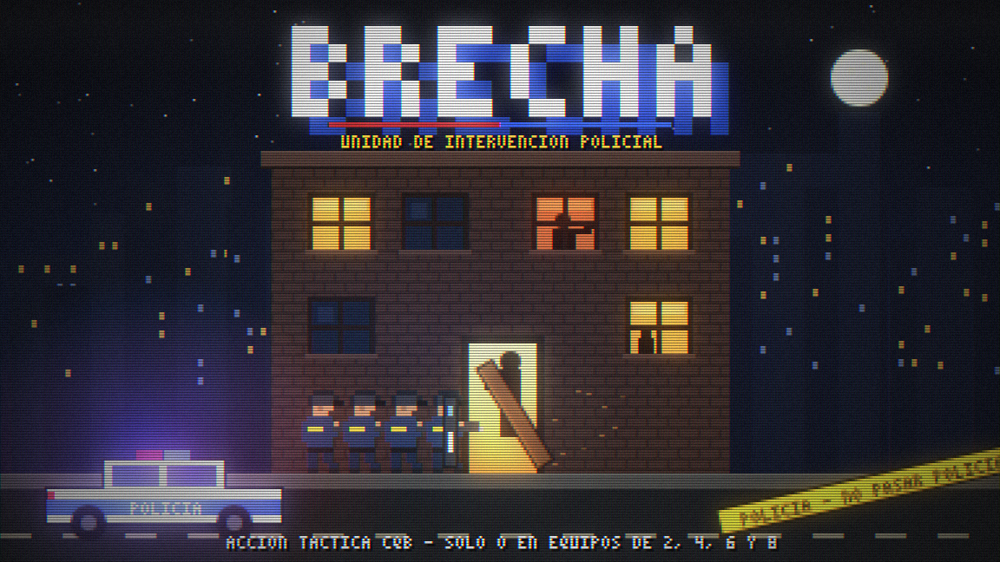

# BRECHA · Unidad de Intervención Policial

## ▶ [Jugar ahora: https://malbot042.github.io/police/](https://malbot042.github.io/police/)



Acción táctica **CQB con vista cenital** en un único `index.html`, sin dependencias, con la misma estética retro que [XENO MARINE](https://github.com/malbot042/alien). Formas parte de una unidad de intervención: entras en el edificio, despejas sala a sala y **detienes a los sospechosos**. Disparar es el último recurso: se puntúa más detener que abatir, y se penaliza a quien dispara a alguien que se rinde o a un civil.

Se juega con teclado y ratón, con mando o en el móvil con controles táctiles. Se dibuja a la resolución de tu pantalla: personajes vectoriales animados, texto nítido, niebla con bordes difuminados y movimiento y cámara sin saltos de píxel. Por encima va un filtro CRT suave (líneas de barrido, separación de colores y brillo) que se quita con **K**.

## Campaña: Operación Marea Negra
Ocho misiones encadenadas. Cada una empieza con un **informe de la central** y, al terminarla, la central cuenta qué habéis descubierto y adónde lleva la pista. Para abrir la siguiente misión hay que completar la anterior.

| # | Misión | Escenario | Agentes | Armas |
|---|---|---|---|---|
| 1 | Orden de detención | Piso | Solo | Pistola |
| 2 | Narcopiso | Piso | 2 | Pistola, escopeta |
| 3 | Taller clandestino | Nave con aparcamiento y vigía | 4 | Pistola, subfusil |
| 4 | Atraco al banco | Banco con cámara acorazada y rehenes | 6 | Pistola, fusil, escopeta |
| 5 | Fiesta en el club | Club lleno de civiles | 4 | Pistola, subfusil |
| 6 | Laboratorio de droga | Nave con patio y aparcamiento | 2 | Pistola, subfusil, escopeta |
| 7 | Mansión del capo | Mansión de **dos plantas** con patio | 6 | Todas |
| 8 | Almacén portuario | Almacén de **dos plantas** con aparcamiento y rehenes | 8 | Todas |

### Desafíos y desbloqueos
Cada misión tiene tres desafíos, y cada uno da una ★:
- sin bajas propias ni civiles;
- todos los sospechosos detenidos (ninguno abatido);
- terminar antes del tiempo marcado.

Las estrellas (máximo 24) desbloquean equipo:

| Estrellas | Equipo |
|---|---|
| 2 | Escudo balístico |
| 4 | Cámara de puerta |
| 6 | Ariete |
| 9 | Carga explosiva (×2) |
| 12 | Aturdidoras +2 |

## Operación aleatoria
Modo infinito, como el de XENO MARINE. El escenario, el número de agentes, las armas, las plantas y las amenazas salen al azar. Cada operación superada suma puntos y la siguiente es más dura; si caes, se acaba. Hay un top 10 por dificultad.

## Informe y planificación
Antes de desplegar eliges:
- **Arma principal** (de las que permite la misión) o el **escudo balístico**: bloquea los disparos que te llegan de frente, pero solo permite usar la pistola y te hace más lento.
- **Dos huecos de equipo táctico** (teclas **T** e **Y**):
  - **Cámara de puerta:** ves la sala de detrás de una puerta cerrada durante 4 segundos.
  - **Ariete:** se mantiene la tecla pulsada y abre cualquier puerta, también las blindadas.
  - **Carga explosiva:** revienta la puerta y aturde a toda la sala (cuidado con los rehenes).
  - **Aturdidoras extra.**
- **Agente:** hombre o mujer (tu voz y tu aspecto). El equipo mezcla agentes de ambos sexos.
- **Plano y entradas** (tecla **Tab** en el informe): ves el plano del edificio (paredes, puertas, puertas blindadas, ventanas y escaleras, planta por planta) y eliges por qué puerta entra **Alfa** (contigo) y por cuál entra **Bravo**: principal, trasera, lateral o azotea. Si Bravo entra por otra puerta, empieza **apilado** en ella; durante la misión, con **B**, los dos grupos revientan sus puertas a la vez. El plano también aparece tenue en el minimapa.

## Cómo se juega
- **Niebla de guerra:** solo ves lo que tú, tu equipo o tu cámara tenéis en línea de visión. Las paredes y las puertas cerradas tapan la vista; las ventanas no.
- **Puertas:** se abren al empujarlas o con **E**. Con **F** les das una patada que aturde un instante a quien esté detrás. El punto rojo indica una puerta **cerrada con llave** (se abre a patadas). Las **blindadas** (gris metálico, punto naranja) solo se abren con ariete o carga.
- **¡Policía!** Con **Espacio** gritas para identificarte. Los sospechosos pueden rendirse: es más probable si están aturdidos, heridos, desarmados o rodeados.
- **Voces:** sospechosos, civiles, compañeros y la operadora de la central hablan con **voces masculinas y femeninas**. Cada personaje tiene su propio timbre y velocidad, y la **entonación cambia con la emoción**: órdenes firmes, súplicas al rendirse, pánico de los civiles, amenazas de los captores o preguntas cuando oyen algo («¿Quién anda ahí?»). Las frases se dicen por partes («¡Policía!… ¡Al suelo!») y la voz baja si quien habla está lejos o detrás de una pared. Los compañeros lejanos o en otra planta hablan **por radio**, con su chasquido de entrada y salida. El texto aparece también sobre quien habla, aunque no lo veas. Las voces son las del sintetizador del navegador: cuantas más voces en español tenga tu sistema, más variedad.
- **Sonido realista:** disparos por capas (chasquido, estampido, golpe grave y eco de la sala) distintos según el arma, reverberación, **sonido posicional** (izquierda/derecha y distancia), sonidos amortiguados tras paredes o desde otra planta, y **pasos** de todos los personajes: oirás a un sospechoso moverse al otro lado de la puerta.
- **Detener:** acércate a un sospechoso rendido o aturdido y **mantén E** para esposarlo. Las armas que suelten se aseguran al pasar por encima.
- **Civiles y rehenes:** mantén **E** junto a ellos para ponerlos a salvo; salen solos del edificio.
- **Salas a oscuras:** algunas salas no tienen luz. Solo ves lo que alumbran las **linternas** del equipo (conos de luz que no atraviesan paredes), los fogonazos y las explosiones. Con **L** apagas tu linterna: a oscuras los sospechosos casi no te ven, pero tú tampoco a ellos. Con la linterna encendida, en cambio, te detectan aunque no miren hacia ti.
- **Humo:** las explosiones, las aturdidoras, las puertas reventadas y los disparos dejan humo que se disipa poco a poco.
- **Personajes animados:** agentes, sospechosos y civiles se dibujan en alta resolución, con piernas que se mueven al andar, armas y escudo en las manos, manos en alto al rendirse, esposados a la espalda y animación de recarga en la que cae el cargador al suelo.
- **Plantas y escaleras:** las escaleras (flechas amarillas) se usan pisándolas. El minimapa muestra la planta actual.
- **Salas con función:** cocina, baños, dormitorios, oficinas, archivo, cámara acorazada, pista de baile, sala VIP, laboratorio, despacho, biblioteca, taller, garaje, patio… cada una con sus muebles. Abajo aparece el nombre de la sala en la que estás.

## Equipo: grupos Alfa y Bravo
Tus compañeros se dividen en **Alfa** (azul) y **Bravo** (turquesa). Con **Tab** eliges a quién das la orden: *todos*, *Alfa* o *Bravo*.

| Tecla | Orden |
|---|---|
| C | Seguir / esperar |
| V | Ir a la posición del cursor |
| X | **Apilarse** en la puerta señalada con el cursor: se colocan pegados a la pared, a los dos lados. Si repites X sobre la misma puerta, cambias el método: abrir, patada o aturdidora |
| B | **¡Adelante!** Todos los grupos apilados entran **a la vez**: el primero abre o revienta la puerta (o lanza la aturdidora), entran y se reparten las esquinas de la sala |

Cuando te siguen, también se colocan solos: si te paras junto a una puerta cerrada se apilan a tu lado, y al entrar en una sala cubren sus esquinas y avisan con «¡Despejado!» o «¡Contacto!».

Además gritan para pedir la rendición, no disparan si hay un civil o un compañero en la línea de tiro, esposan a los rendidos, ponen a salvo a los civiles, patean las puertas cerradas con llave, ponen cargas en las blindadas y bajan o suben escaleras para seguirte.

## Informe final
El informe muestra la puntuación, el rango (S a D), los desafíos cumplidos, lo que se ha desbloqueado y un **mapa del edificio** con lo que pasó: dónde se detuvo o abatió a cada sospechoso y quién lo hizo, los civiles rescatados, las pruebas y las bajas. En los edificios de dos plantas se cambia de planta con ←/→.

## Armas
| Tecla | Arma | Características |
|---|---|---|
| P | Pistola (arma corta) | Precisa, 15 balas por cargador |
| S | Subfusil (arma larga) | Ráfaga rápida, 30 balas |
| F | Fusil | Mucho daño, atraviesa a un objetivo |
| E | Escopeta | Perdigones a corta distancia, recarga cartucho a cartucho |
| B | Escudo + pistola | Bloquea los disparos de frente; más lento |

Caminar con **Shift** (sigilo) es más lento pero más preciso; disparar corriendo abre la dispersión.

## Puntuación
| Acción | Puntos |
|---|---|
| Sospechoso detenido | +100 |
| Sospechoso armado neutralizado | +25 |
| Civil a salvo | +50 |
| Prueba recogida | +75 |
| Arma asegurada | +10 |
| Capo detenido vivo / abatido | +300 / −150 |
| Fuerza injustificada (rendido o desarmado abatido) | −150 |
| Civil herido / muerto por la policía | −40 / −300 |
| Rehén perdido | −100 |
| Agente caído | −120 |
| Bonus de tiempo | variable |

## Dificultad
| | Fácil | Medio | Difícil |
|---|---|---|---|
| Daño recibido | 55 % | 100 % | 140 % |
| Reacción de los sospechosos | Lenta | Normal | Rápida |
| Puntería de los sospechosos | Peor | Normal | Mejor |
| Disposición a rendirse | Alta | Normal | Baja |
| Rendiciones fingidas | No | A veces | A menudo |
| Granadas aturdidoras | 4 | 3 | 2 |
| Puntos | ×0,75 | ×1 | ×1,5 |

## Controles
| Teclado y ratón | Acción |
|---|---|
| WASD | Moverse |
| Shift | Sigilo (más preciso) |
| Ratón + clic izquierdo / flechas | Apuntar y disparar |
| Espacio | Gritar «¡Policía!» |
| E (mantener) | Esposar, poner a salvo, recoger pruebas |
| E / F | Abrir o cerrar puerta / patada |
| G / clic derecho | Granada aturdidora |
| T / Y | Equipo táctico 1 / 2 |
| L | Linterna sí / no |
| 1–2, Q, rueda / R | Cambiar de arma / recargar |
| Tab | Elegir grupo: todos, Alfa, Bravo |
| C / V / X / B | Seguir-esperar / ir / apilarse / ¡adelante! |
| P / Esc | Pausa (Enter en pausa: abandonar) |
| M / N / Z | Sonido / minimapa / zoom |
| K | Filtro CRT sí / no |
| H | Controles (en la portada) |

**Mando:** sticks para moverse y apuntar, RT disparar, A usar, B gritar, X recargar, Y cambiar arma, LT aturdidora, RB patada, LB elegir grupo, Select / R3 equipo táctico. En la cruceta: arriba apilarse, abajo ¡adelante!, izquierda ir y derecha seguir/esperar.

**Móvil** (en horizontal): mitad izquierda para moverse, mitad derecha para apuntar y disparar, y botones GRITO, E, PAT, ATU, ARM, T, GRP, SEG, PILA, YA, pausa y zoom.

## Jugar en local
Descarga el repositorio y abre `index.html` en el navegador. Con `index.html?portada` se muestra la portada sin menús.

> Para que la dirección de GitHub Pages funcione, Pages debe estar activado en **Settings → Pages → Deploy from a branch → rama `main`, carpeta `/ (root)`**.

## Desarrollo
El código está dividido en `src/` y se une en `index.html` con:

```
node build.js           # genera index.html
node build.js --check   # comprueba que index.html está al día
```

| Fichero | Contenido |
|---|---|
| `00_cabecera.html` | HTML, estilos, lienzos y utilidades |
| `01_fuente.js` | Fuente de píxeles (portada antigua) |
| `02_graficos_mapa.js` | Texto, sprites, baldosas, temas, salas, generador de mapas y muebles |
| `03_audio_voces.js` | Motor de sonido, efectos posicionales, música y voces |
| `04_nucleo.js` | Datos (dificultades, armas, misiones), plantas, colisiones, puertas, gritos |
| `05_logica.js` | Preparación y despliegue, jugador, órdenes de grupo, IA, daño, partida |
| `06_render.js` | Visión, niebla, oscuridad, personajes, mundo y HUD |
| `07_portada.js` | Portada |
| `08_interfaz.js` | Menús, informe, plano, resultados y pausa |
| `09_pantalla_entrada.js` | Filtro CRT, tamaño de pantalla, teclado, ratón, mando y táctil |
| `10_bucle.js` | Estados del juego y bucle principal |

Hay que editar los ficheros de `src/` y volver a generar `index.html`, que es el que publica GitHub Pages.
